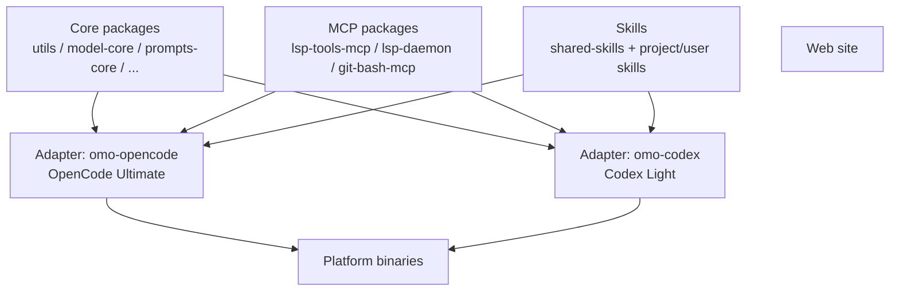

# oh-my-openagent 架构分析

## 1. 项目定位

`oh-my-openagent` 不是传统意义上的单体插件，而是一个围绕“代理自主完成复杂任务”构建的多层 monorepo。项目自己的路线图把它定义为 “a harness for agents”，强调的是让 agent 成为真正的执行者，而不是让人类持续待在环里修正细节。[ROADMAP.md](/Users/liulei/aiS/oh-my-openagent/ROADMAP.md:11)

从架构目标上看，这个仓库正在从“面向 OpenCode 的大型插件”重构成“跨多种 harness 复用的 agent OS 基础设施”。OpenCode 只是当前最重要的宿主，不再是唯一中心。[ROADMAP.md](/Users/liulei/aiS/oh-my-openagent/ROADMAP.md:66)

## 2. 顶层分层

仓库当前按 6 类角色组织 package：

- `Core`：纯 TypeScript 核心逻辑，尽量不依赖具体宿主。
- `MCP`：通过 stdio 暴露工具能力的外部进程服务。
- `Adapters`：针对 OpenCode、Codex 这类宿主的适配层。
- `Skills`：以 `SKILL.md` 为载体的声明式知识层。
- `Platform`：编译后的平台二进制分发包。
- `Web`：独立的营销站点。

这套角色划分在 [packages/AGENTS.md](/Users/liulei/aiS/oh-my-openagent/packages/AGENTS.md:9) 和 [ROADMAP.md](/Users/liulei/aiS/oh-my-openagent/ROADMAP.md:27) 中是一致的。作者明确要求依赖方向只能向下流动：`Adapter -> Core/MCP/Skills`，而不是让 Core 反过来依赖某个具体 harness。[ROADMAP.md](/Users/liulei/aiS/oh-my-openagent/ROADMAP.md:38)

可以把它理解成下面这张图：

## 3. 两个主要适配器

### 3.1 `packages/omo-opencode`

这是主插件，也就是 OpenCode Ultimate edition。它是当前 npm 主构建入口，承担了 11 个 agent、约 53 到 60 个 hook、原生 tools、built-in MCP、feature modules 等核心运行时职责。[packages/AGENTS.md](/Users/liulei/aiS/oh-my-openagent/packages/AGENTS.md:67)

### 3.2 `packages/omo-codex`

这是 Codex CLI 的轻量适配版，也就是 lazycodex 对应的源码层。它保留的是 Codex 侧需要的插件组件、安装器、遥测和兼容层，而不是把 OpenCode 侧的全部能力完整搬过去。[packages/omo-codex/AGENTS.md](/Users/liulei/aiS/oh-my-openagent/packages/omo-codex/AGENTS.md:1)

这两个适配器共同说明一个事实：项目已经不是“一个只给 OpenCode 用的插件仓库”，而是在演进成“同一套 agent 能力在多个宿主中的分发与编排系统”。

## 4. OpenCode 插件内部结构

`packages/omo-opencode/src` 可以看作 OpenCode 运行时总装层。它不是把所有逻辑都写死在这里，而是把各个 manager、tool、hook、agent、feature 组合起来，再统一接到 OpenCode 的插件 API 上。[packages/omo-opencode/src/AGENTS.md](/Users/liulei/aiS/oh-my-openagent/packages/omo-opencode/src/AGENTS.md:22)

内部最重要的子系统有：

- `agents/`：11 个内置 agent 和动态 prompt builder。[packages/omo-opencode/src/AGENTS.md](/Users/liulei/aiS/oh-my-openagent/packages/omo-opencode/src/AGENTS.md:106)
- `hooks/`：生命周期 hook 体系，是整个 agent loop 的主要注入层。[packages/omo-opencode/src/AGENTS.md](/Users/liulei/aiS/oh-my-openagent/packages/omo-opencode/src/AGENTS.md:111)
- `tools/`：一方工具层，如 `task`、`skill`、`call_omo_agent`、`background_*` 等。[packages/omo-opencode/src/AGENTS.md](/Users/liulei/aiS/oh-my-openagent/packages/omo-opencode/src/AGENTS.md:112)
- `features/`：team mode、skill-MCP、background-agent、OpenClaw、Claude/Codex 兼容等扩展特性。[packages/omo-opencode/src/AGENTS.md](/Users/liulei/aiS/oh-my-openagent/packages/omo-opencode/src/AGENTS.md:113)
- `plugin/` 与 `plugin-interface.ts`：唯一直接接 OpenCode 插件 API 的边界层。[packages/omo-opencode/src/AGENTS.md](/Users/liulei/aiS/oh-my-openagent/packages/omo-opencode/src/AGENTS.md:128)

## 5. 插件启动链路

OpenCode 侧的真实入口在 [packages/omo-opencode/src/testing/create-plugin-module.ts](/Users/liulei/aiS/oh-my-openagent/packages/omo-opencode/src/testing/create-plugin-module.ts:106)。虽然文件位于 `testing/`，但这里实际定义了插件模块的 `serverPlugin` 初始化流程。

关键步骤可以概括为：

1. 初始化配置上下文与兼容开关。
2. 检测重复插件和外部 skill 插件冲突。
3. 注入 OpenCode server auth。
4. 加载并迁移插件配置。
5. 初始化 live server route、runtime skills、i18n、agent 排序。
6. 按配置启动 OpenClaw、team mode、tmux 检查。
7. 组装 `managers`、`tools`、`hooks`。
8. 生成最终的 `pluginInterface` 并挂上 compaction/dispose 生命周期。

对应代码可直接看 [create-plugin-module.ts](/Users/liulei/aiS/oh-my-openagent/packages/omo-opencode/src/testing/create-plugin-module.ts:108) 到 [create-plugin-module.ts](/Users/liulei/aiS/oh-my-openagent/packages/omo-opencode/src/testing/create-plugin-module.ts:220)。

这个初始化顺序说明，项目的核心不是“加载几个 prompt”，而是先搭好运行时基础设施，再把 agent loop 接上去。

## 6. 插件 API 边界

真正和 OpenCode `Plugin` API 对接的地方在 [plugin-interface.ts](/Users/liulei/aiS/oh-my-openagent/packages/omo-opencode/src/plugin-interface.ts:20)。这个文件把内部能力映射到 OpenCode 的 hook 面：

- `config`
- `chat.params`
- `chat.headers`
- `chat.message`
- `experimental.chat.messages.transform`
- `experimental.chat.system.transform`
- `event`
- `tool.definition`
- `tool.execute.before`
- `tool.execute.after`
- `command.execute.before`

这意味着其余大多数目录并不直接依赖 OpenCode 插件 API，而是依赖内部抽象，再由 `plugin-interface.ts` 统一接线。[plugin-interface.ts](/Users/liulei/aiS/oh-my-openagent/packages/omo-opencode/src/plugin-interface.ts:36)

这是这套架构能支持“多 harness 适配”的关键原因之一。

## 7. Hook-first 的系统设计

项目最鲜明的特征之一是 hook 数量非常多，而且被明确分层组织。`createHooks()` 会把 hook 组合成 5 层：

- Session hooks
- Tool guard hooks
- Transform hooks
- Continuation hooks
- Skill hooks

基础模式下总计 53 个 hook，开启 team mode 后可到 60 个。[packages/omo-opencode/src/AGENTS.md](/Users/liulei/aiS/oh-my-openagent/packages/omo-opencode/src/AGENTS.md:68)

这反映出作者的设计偏好是：

- Skill 负责静态知识
- MCP 负责外部进程工具
- Tool 负责一方能力
- Hook 负责改写 agent loop

这个层级关系在路线图中也被直接写成了架构哲学。[ROADMAP.md](/Users/liulei/aiS/oh-my-openagent/ROADMAP.md:57)

## 8. 为什么说它是“Agent OS”而不是普通插件

从代码组织和理念上看，这个项目已经具备了 agent 操作系统的几个典型特征：

- 有多角色 agent 体系，而不是单一助手。
- 有 hook、tool、skill、MCP 多层扩展面。
- 有 model routing、fallback、tool restriction、permission 等调度逻辑。
- 有 team mode、多 worktree、多 mailbox 的并行协作模型。
- 有 OpenCode 与 Codex 两个适配层，且继续朝多 harness 演化。

所以更准确的理解方式是：

`oh-my-openagent = 一套以 agent loop 为核心的运行时系统 + 宿主适配器`

而不只是：

`oh-my-openagent = OpenCode 的一个功能插件`

## 9. 读源码建议

如果你后面想继续深入，这样读会更顺：

1. 先看 [ROADMAP.md](/Users/liulei/aiS/oh-my-openagent/ROADMAP.md:1)，建立设计目标。
2. 再看 [packages/AGENTS.md](/Users/liulei/aiS/oh-my-openagent/packages/AGENTS.md:1)，搞清 monorepo 分层。
3. 接着看 [packages/omo-opencode/src/AGENTS.md](/Users/liulei/aiS/oh-my-openagent/packages/omo-opencode/src/AGENTS.md:22)，掌握 OpenCode 总装层。
4. 然后顺着 [create-plugin-module.ts](/Users/liulei/aiS/oh-my-openagent/packages/omo-opencode/src/testing/create-plugin-module.ts:106) 看启动链路。
5. 最后从 [plugin-interface.ts](/Users/liulei/aiS/oh-my-openagent/packages/omo-opencode/src/plugin-interface.ts:20) 往回追各个 hook、tool、agent 的实现。

## 10. 一句话总结

这个仓库的主线不是“实现某个单点功能”，而是“搭建一个能让多个 agent 在不同 harness 中稳定运行、规划、委派、执行和协作的系统”。
