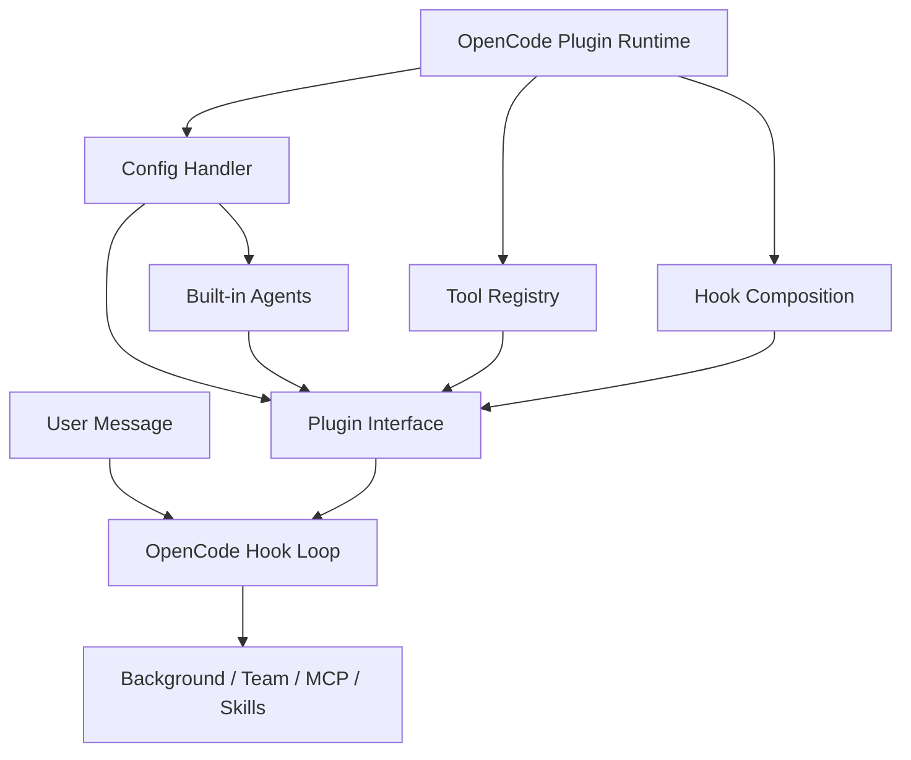
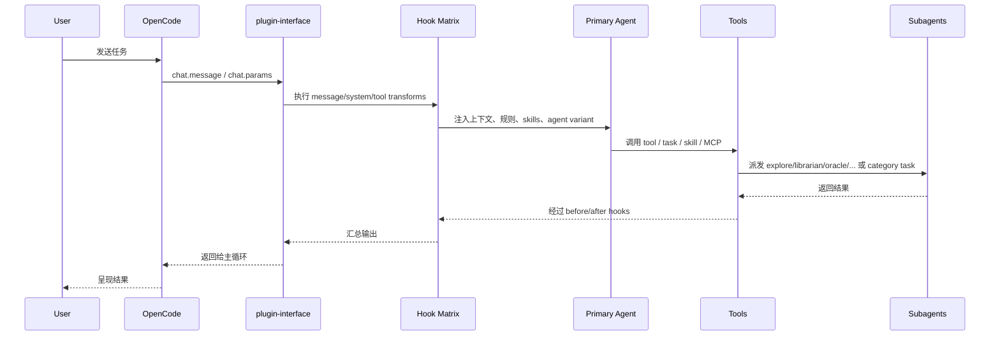

# oh-my-openagent 运行时执行链路

## 1. 这份文档讲什么

这份文档不再从“目录结构”出发，而是从“用户发出一条请求后，系统内部发生了什么”出发，按源码链路把 OpenCode 侧运行过程串起来。

重点关注 4 个问题：

- 插件是怎么启动的
- agent 是什么时候注册出来的
- hooks 和 tools 是怎么接入主循环的
- 一次任务是怎么从用户输入流到 agent 执行的

## 2. 入口：插件模块创建

OpenCode 适配器的入口在 [create-plugin-module.ts](/Users/liulei/aiS/oh-my-openagent/packages/omo-opencode/src/testing/create-plugin-module.ts:106)。这里定义了 `createPluginModule()`，返回 `{ id, server }` 结构；其中 `serverPlugin` 才是真正的启动函数。

在这个阶段，系统做的不是“立即响应用户消息”，而是先把运行时底座搭起来：

1. 安装 agent 排序 shim。
2. 初始化配置上下文。
3. 记录日志、迁移旧工作目录。
4. 检测重复插件与外部 skill 插件冲突。
5. 注入 server auth。
6. 加载插件配置。
7. 初始化 live route、runtime security skills、i18n。
8. 根据配置启动 OpenClaw、team mode、tmux 检查。
9. 创建 managers、tools、hooks。
10. 生成 plugin interface 并把它挂回 OpenCode。

这条链路见 [create-plugin-module.ts](/Users/liulei/aiS/oh-my-openagent/packages/omo-opencode/src/testing/create-plugin-module.ts:108) 到 [create-plugin-module.ts](/Users/liulei/aiS/oh-my-openagent/packages/omo-opencode/src/testing/create-plugin-module.ts:220)。

## 3. 运行时大图

可以把运行时理解成下面这张图：

核心意思是：真正进入 OpenCode 主循环之前，agent、tool、hook 都已经先被拼装完了。

## 4. Agent 是怎么被注册的

内置 agent 的统一入口是 [builtin-agents.ts](/Users/liulei/aiS/oh-my-openagent/packages/omo-opencode/src/agents/builtin-agents.ts:61) 的 `createBuiltinAgents()`。

这个函数会做几件事：

1. 读取已连接 provider 和可用模型。
2. 合并 category 配置，生成运行时可见的 category 列表。
3. 先收集一般 agent 的候选配置。
4. 单独处理 `Sisyphus`。
5. 单独处理 `Hephaestus`。
6. 再把普通 agent 插入结果。
7. 最后单独处理 `Atlas`。

这里可以看到一个重要事实：`Sisyphus`、`Hephaestus`、`Atlas` 不是和别的 agent 完全平级注册的，而是被当作更核心的控制角色看待。[builtin-agents.ts](/Users/liulei/aiS/oh-my-openagent/packages/omo-opencode/src/agents/builtin-agents.ts:122)

`Prometheus` 则更特殊，它根本不在这里注册，而是单独通过 [prometheus-agent-config-builder.ts](/Users/liulei/aiS/oh-my-openagent/packages/omo-opencode/src/plugin-handlers/prometheus-agent-config-builder.ts:33) 构建。

## 5. Hooks 是怎么接入主循环的

hook 不是零散散落在系统里的，而是统一通过 `createHooks()` 组合起来，再交给 `plugin-interface.ts` 暴露给 OpenCode。[packages/omo-opencode/src/AGENTS.md](/Users/liulei/aiS/oh-my-openagent/packages/omo-opencode/src/AGENTS.md:68)

分层如下：

- `Session hooks`
- `Tool guard hooks`
- `Transform hooks`
- `Continuation hooks`
- `Skill hooks`

基础场景下 53 个 hook，team mode 时增加到 60 个。[packages/omo-opencode/src/AGENTS.md](/Users/liulei/aiS/oh-my-openagent/packages/omo-opencode/src/AGENTS.md:104)

这意味着一次消息处理并不是“agent prompt -> tool 调用 -> 输出”这么简单，而是会经过很多横切逻辑，例如：

- 上下文注入
- 规则注入
- 工具调用前校验
- 输出截断
- compaction 续跑
- runtime fallback
- team mailbox 注入

## 6. Plugin Interface：唯一宿主边界

真正暴露给 OpenCode 的边界是 [plugin-interface.ts](/Users/liulei/aiS/oh-my-openagent/packages/omo-opencode/src/plugin-interface.ts:20)。

它把内部组装好的能力映射到 OpenCode 的 hook 名称上：

- `chat.params`
- `chat.headers`
- `chat.message`
- `experimental.chat.messages.transform`
- `experimental.chat.system.transform`
- `config`
- `event`
- `tool.definition`
- `tool.execute.before`
- `tool.execute.after`
- `command.execute.before`

这一步非常关键，因为它把“宿主适配”和“内部行为实现”隔开了。也就是说，真正依赖 OpenCode 的地方很薄，大部分逻辑是内部系统自己管理的。

## 7. 一次消息的典型流转

如果把一次普通复杂任务的执行过程拉直，大致会像这样：

这里最重要的是：主 agent 的行动并不是直接裸跑，而是一直被 hook、tool guard、skill 约束和增强。

## 8. 一次复杂实现任务的典型路径

如果任务比较复杂，常见路径会是：

1. `chat.message` 进入后，系统先根据配置和 variant 做 prompt 调整。
2. 主 agent 读取自身 prompt，其中可能已经动态包含 agent 列表、skills、categories 和政策约束。
3. 主 agent 判断任务复杂度。
4. 若需要搜索内部代码，调用 `explore` 或直接搜索工具。
5. 若需要外部文档，调用 `librarian`。
6. 若需要更强判断，调用 `oracle` 或规划型 agent。
7. 若进入实施阶段，可能通过 `task()` 走 category + skill 委派。
8. 所有工具调用前后都会经过 guard/transform hooks。
9. 最终结果再通过 OpenCode 主循环回到用户侧。

## 9. 为什么这条链路重要

如果只看 prompt，很容易误以为项目的“智能”主要来自某个 agent 文案。

但从源码看，真正让系统表现出复杂行为的，其实是以下四层的叠加：

- `agent registration`
- `dynamic prompt composition`
- `hook composition`
- `tool / task / skill / MCP runtime`

也就是说，这个项目的核心不是一段很强的 system prompt，而是一套完整的运行时编排机制。

## 10. 阅读建议

如果你要继续顺着源码往下挖，推荐顺序是：

1. [create-plugin-module.ts](/Users/liulei/aiS/oh-my-openagent/packages/omo-opencode/src/testing/create-plugin-module.ts:106)
2. [builtin-agents.ts](/Users/liulei/aiS/oh-my-openagent/packages/omo-opencode/src/agents/builtin-agents.ts:61)
3. [plugin-interface.ts](/Users/liulei/aiS/oh-my-openagent/packages/omo-opencode/src/plugin-interface.ts:20)
4. `create-hooks.ts` 及各 hook 目录
5. `create-tools.ts` 与 `tools/`
6. 具体核心 agent 的工厂与 prompt builder

## 11. 一句话总结

`oh-my-openagent` 的运行时链路，本质上是“先装配 agent OS，再把它接到 OpenCode 的 hook loop 上”。
