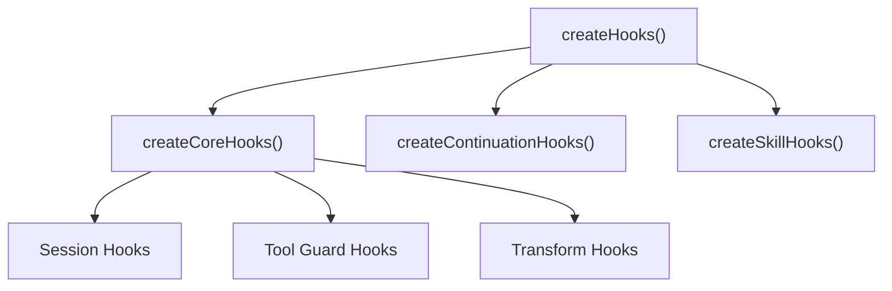

# Hooks 治理层架构导读

## 1. 为什么 hooks 是这个项目的真正骨架

如果只看 agent，容易觉得这个项目的核心是“多角色 prompt 系统”。但从源码结构看，真正把这些 agent 治理起来的，是 hook 层。

在 [ROADMAP.md](/Users/liulei/aiS/oh-my-openagent/ROADMAP.md:57) 里，作者直接把表达层级写成：

1. Skill
2. MCP
3. Tool
4. Hook

而 hook 被定义成“注入到 agent loop 本身”。这其实已经说明：hook 不是装饰层，而是系统控制面的核心。

## 2. 顶层入口：`createHooks()`

总入口在 [create-hooks.ts](/Users/liulei/aiS/oh-my-openagent/packages/omo-opencode/src/create-hooks.ts:36)。

这里的逻辑很简单：

1. 先创建 `core hooks`
2. 再创建 `continuation hooks`
3. 再创建 `skill hooks`
4. 最后把三类合并，并返回一个带 `disposeHooks()` 的对象

从结构上看，它像一个总装配器。

## 3. Core hooks：主循环的基础治理层

`core hooks` 的入口在 [create-core-hooks.ts](/Users/liulei/aiS/oh-my-openagent/packages/omo-opencode/src/plugin/hooks/create-core-hooks.ts:12)。

它继续拆成三类：

- `session hooks`
- `tool guard hooks`
- `transform hooks`

这三个几乎对应 agent loop 的三种不同切面：

- 会话状态治理
- 工具调用前后治理
- 消息与上下文变换治理

## 4. Session hooks：会话状态控制面

[create-session-hooks.ts](/Users/liulei/aiS/oh-my-openagent/packages/omo-opencode/src/plugin/hooks/create-session-hooks.ts:43) 注册的 hook 最多，也最像“系统守护层”。

这里包括：

- `preemptiveCompaction`
- `sessionNotification`
- `thinkMode`
- `modelFallback`
- `anthropicContextWindowLimitRecovery`
- `autoUpdateChecker`
- `codegraphBootstrap`
- `astGrepSgProvision`
- `agentUsageReminder`
- `nonInteractiveEnv`
- `interactiveBashSession`
- `ralphLoop`
- `editErrorRecovery`
- `delegateTaskRetry`
- `startWork`
- `prometheusMdOnly`
- `sisyphusJuniorNotepad`
- `noSisyphusGpt`
- `noHephaestusNonGpt`
- `hephaestusAgentsMdInjector`
- `questionLabelTruncator`
- `taskResumeInfo`
- `runtimeFallback`
- `legacyPluginToast`

从这份清单就能看出，session hooks 不只是“session 生命周期通知”，而是在做：

- 模型策略约束
- 运行时故障恢复
- agent 行为边界控制
- 任务恢复和续跑
- 宿主环境修补

## 5. `prometheusMdOnly` 很能说明 hook 的作用

`prometheusMdOnly` 是个很典型的例子。[create-session-hooks.ts](/Users/liulei/aiS/oh-my-openagent/packages/omo-opencode/src/plugin/hooks/create-session-hooks.ts:189)

它说明：

- agent permission 本身不是最终安全边界
- 真正的策略边界可以在 hook 层强制实施

这也解释了为什么 `Prometheus` 虽然 permission 里允许 `edit`，却仍然只能在 `.md` 范围内活动。

## 6. Tool guard hooks：工具调用治理层

[create-tool-guard-hooks.ts](/Users/liulei/aiS/oh-my-openagent/packages/omo-opencode/src/plugin/hooks/create-tool-guard-hooks.ts:33) 负责的是工具调用的前后护栏。

这里的 hook 包括：

- `commentChecker`
- `toolOutputTruncator`
- `directoryAgentsInjector`
- `directoryReadmeInjector`
- `emptyTaskResponseDetector`
- `rulesInjector`
- `tasksTodowriteDisabler`
- `writeExistingFileGuard`
- `bashFileReadGuard`
- `hashlineReadEnhancer`
- `jsonErrorRecovery`
- `readImageResizer`
- `todoDescriptionOverride`
- `webfetchRedirectGuard`
- `fsyncSkipWarning`
- `teamToolGating`
- `notepadWriteGuard`
- `planFormatValidator`

这一层的作用很像“runtime lint + guardrail”：

- 防止误用工具
- 修正工具输出
- 给工具加附加语义
- 拦截不合规调用

## 7. 这一层为什么关键

很多 agent 系统的问题，是工具层裸露得太直接，模型一旦发起不合规调用，就只能靠 prompt 自觉。

这个仓库不一样，它把很多约束下沉到了 hook 层。例如：

- 写已存在文件时拦截
- webfetch 被重定向到更符合项目规范的使用方式
- todo/task 描述被统一修正
- 团队模式下某些工具会被额外 gating

这会显著降低“模型一时冲动就乱用工具”的风险。

## 8. Transform hooks：消息治理层

[create-transform-hooks.ts](/Users/liulei/aiS/oh-my-openagent/packages/omo-opencode/src/plugin/hooks/create-transform-hooks.ts:20) 管的是消息变换和上下文注入。

这里包括：

- `claudeCodeHooks`
- `keywordDetector`
- `contextInjectorMessagesTransform`
- `teamModeStatusInjector`
- `teamMailboxInjector`
- `toolPairValidator`
- `monitorStatusInjector`

这一层可以理解为“在 agent 真正看到消息之前，先把上下文和约束整理好”。

尤其关键的点：

- `keywordDetector` 会把关键词触发逻辑接进来
- `contextInjectorMessagesTransform` 负责上下文注入
- `teamMailboxInjector` 和 `teamModeStatusInjector` 把 team mode 状态塞回主循环

这说明很多“agent 突然知道了什么”的行为，并不是 prompt 自己推出来的，而是 transform hooks 提前喂进去的。

## 9. Continuation hooks：续跑与长任务治理

[create-continuation-hooks.ts](/Users/liulei/aiS/oh-my-openagent/packages/omo-opencode/src/plugin/hooks/create-continuation-hooks.ts:16) 管的是另一类系统问题：长任务怎么不断掉、压缩上下文后怎么续上、后台任务怎么提醒。

这里包括：

- `stopContinuationGuard`
- `compactionContextInjector`
- `compactionTodoPreserver`
- `todoContinuationEnforcer`
- `unstableAgentBabysitter`
- `backgroundNotificationHook`
- `atlasHook`

这层的意义在于，它把 agent 从“单回合助手”提升成“能跨回合延续任务的 worker”。

特别是：

- compaction 相关 hook 负责上下文压缩后的续接
- background notification 负责后台任务结果回流
- `atlasHook` 把 `Atlas` 这类计划推进器接进 continuation 流

## 10. Skill hooks：技能系统和主循环的桥

[create-skill-hooks.ts](/Users/liulei/aiS/oh-my-openagent/packages/omo-opencode/src/plugin/hooks/create-skill-hooks.ts:9) 目前只有两个 hook：

- `categorySkillReminder`
- `autoSlashCommand`

虽然数量少，但作用不小：

- `categorySkillReminder` 会提醒 category 与 skill 的组合关系
- `autoSlashCommand` 会根据技能体系自动接 slash command 行为

这层说明 skill 系统不是独立工具箱，而是已经接进主循环的行为面。

## 11. 组合关系图

## 12. 为什么说这是“治理层”而不是“扩展点”

我觉得这里最重要的理解转变是：

- 普通插件架构里，hook 往往是“可选扩展点”
- 在这个项目里，hook 更像“运行时治理策略”

因为它控制的不是某个零散功能，而是：

- 哪些 agent 可以怎么用
- 哪些工具可以怎么调
- 长任务如何持续
- 上下文如何注入
- 规划 agent 如何被约束
- 团队模式状态如何回流

这已经是系统治理，不只是功能扩展。

## 13. 对读源码的人最有帮助的抓手

如果你后面要继续深入 hook 体系，我建议优先按这三个问题去读：

1. 这个 hook 改的是“消息”、“工具”还是“会话状态”？
2. 它是在弥补宿主缺陷，还是在约束 agent 行为？
3. 它是某个功能 hook，还是某个 agent 的策略边界 hook？

这样读会比按目录一个个扫过去更快进入状态。

## 14. 一句话总结

这个仓库的 hook 体系，本质上是一个把 agent loop 变成“可治理运行时系统”的控制层。
