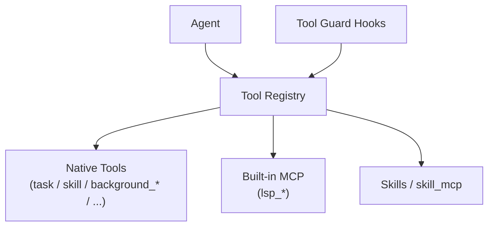

# Tools 能力层导读

## 1. 为什么 tools 层值得单独看

如果把 agent 看作“思考与分工者”，那 tools 层就是它真正能动手的能力面。

本仓库的一个关键特征是：agent 并不是直接裸用宿主的所有能力，而是通过一层经过设计和治理的 native tools 来完成搜索、委派、技能调用、后台任务管理等动作。[packages/omo-opencode/src/tools/AGENTS.md](/Users/liulei/aiS/oh-my-openagent/packages/omo-opencode/src/tools/AGENTS.md:1)

所以理解 tools 层，基本就理解了 agent 在运行时“到底能做什么、怎么做”。

## 2. 总入口：tool registry

工具注册入口在 [plugin/tool-registry.ts](/Users/liulei/aiS/oh-my-openagent/packages/omo-opencode/src/plugin/tool-registry.ts:29)。

这里会把工具分成几块装配：

- `createCoreTools()`
- `interactive_bash`
- `createTeamModeToolsRecord()`
- `createMonitorToolsRecord()`
- `createTaskToolsRecord()`
- `createHashlineToolsRecord()`

然后再经过：

- `normalizeToolArgSchemas()`
- `filterDisabledTools()`
- `trimToolsToCap()`

所以 tool registry 不是简单的“把工具名列出来”，而是一个有开关、有过滤、有裁剪的运行时构建器。

## 3. always-on 工具：系统的基础动作集合

根据 [tools/AGENTS.md](/Users/liulei/aiS/oh-my-openagent/packages/omo-opencode/src/tools/AGENTS.md:9)，始终可用的 native tools 主要分 5 组：

- 搜索：`grep`, `glob`
- 会话：`session_list`, `session_read`, `session_search`, `session_info`
- 后台：`background_output`, `background_cancel`
- 委派：`task`, `call_omo_agent`
- 技能/MCP：`skill`, `skill_mcp`

这几组工具合在一起，其实就是 `oh-my-openagent` 的核心运行时能力面。

## 4. 三个最关键的工具族

### 4.1 `task`

`task` 是真正意义上的“全功能委派工具”。它支持：

- category 路由
- skills 加载
- 同步/异步执行
- continuation session
- specialized subagent 调用

从系统设计上讲，`task` 是“把工作交给另一个 worker”的主通道。

### 4.2 `call_omo_agent`

`call_omo_agent` 则明显更窄。源码与测试都表明，它不是通用代理调度器，而是被刻意限制为只启动某些 lookup/research 类型 agent，尤其是 `explore` 和 `librarian` 一类。[rg 结果里的 `agent-restriction.test.ts` 和 `agent-resolver.ts` 提示了这一点]

也就是说：

- `task` = 通用委派框架
- `call_omo_agent` = 窄用途的命名 agent 调用器

### 4.3 `skill` / `skill_mcp`

这两个工具决定了技能系统如何真正落地：

- `skill`：加载 skill 或调用命令
- `skill_mcp`：调用 skill-embedded MCP 的 tool/resource/prompt

这层很重要，因为它让“SKILL.md 不是文档摆设”，而是可进入执行链的能力源。

## 5. LSP 与 MCP 的关系

一个很容易误会的点是：并不是所有能力都在 `tools/` 目录里作为 native tool 实现。

比如：

- `lsp_*` 工具来自 built-in MCP `lsp`
- `ast-grep` 走的是 skill 路线

也就是说，系统能力是多来源的：

- 一部分是 native tools
- 一部分是 MCP
- 一部分是 skills

这与路线图里“Skill -> MCP -> Tool -> Hook”的层级思路是吻合的。

## 6. 条件工具：为什么会有那么多 gated tools

根据 [tools/AGENTS.md](/Users/liulei/aiS/oh-my-openagent/packages/omo-opencode/src/tools/AGENTS.md:22)，不少工具都是按配置条件启用的：

- `look_at`
- `interactive_bash`
- `task_create` / `task_get` / `task_list` / `task_update`
- `edit`（hashline edit）
- `12 team_* tools`

这说明项目不是默认把所有能力都暴露出去，而是按运行模式裁剪能力面。

这种设计有两个好处：

- 降低上下文复杂度
- 让不同模式下的工具集更稳定、更可预期

## 7. category 是 tools 层里非常关键的抽象

`task` 并不是“把 prompt 发给另一个模型”这么简单，它还会通过 category 选模型和执行策略。[tools/AGENTS.md](/Users/liulei/aiS/oh-my-openagent/packages/omo-opencode/src/tools/AGENTS.md:33)

内建 category 包括：

- `visual-engineering`
- `ultrabrain`
- `deep`
- `artistry`
- `quick`
- `unspecified-low`
- `unspecified-high`
- `writing`

这些 category 的存在说明，tools 层本身就是 agent orchestration 的一部分，而不只是函数接口层。

## 8. `background_*`：把并行变成运行时协议

`background_output` 和 `background_cancel` 看似只是后台任务辅助工具，但实际上它们是整套“并行 delegation 协议”的一部分。

很多 prompt 和实现中都围绕它们建立了约束：

- 背景任务完成后通过 reminder 唤醒
- 不要过早调用 `background_output`
- 用 `bg_...` 任务 ID 取结果
- continuation session ID 则另作他用

这意味着后台任务不是一个随意的异步功能，而是系统性运行模式的一部分。

## 9. `skill_mcp`：能力边界继续向外延伸

`skill_mcp` 的意义在于，它把 skill 声明出来的 MCP server 也接进了 agent 的运行时能力集。

因此 agent 的“可用能力”实际上可以来自：

- 当前 native tools
- tier-1 built-in MCP
- tier-2 / tier-3 skill-embedded MCP
- skills 自身带来的行为规范

这进一步说明本项目不是单一工具箱，而是一个分层能力系统。

## 10. 和 hooks 的关系

tools 层不是独立裸跑的，它会被 hooks 治理：

- 某些工具调用会被 guard
- 某些输出会被截断或增强
- 某些模式下会被禁用或重写
- 团队模式下还会额外被 `team-tool-gating`

所以更准确地说，tool registry 给 agent 暴露的是“经过治理的能力面”，而不是“原始能力面”。

## 11. 一个简化视图

## 12. 一句话总结

这个项目的 tools 层，本质上是把“搜索、委派、技能、后台任务、MCP”统一包装成 agent 可调用的运行时能力面。
