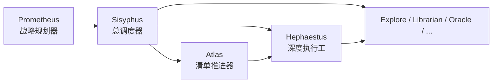

# oh-my-openagent 核心 Agent 源码导读

## 1. 这份导读的范围

这份文档聚焦源码层的阅读路径，主要讲三个核心 agent：

- `Sisyphus`
- `Hephaestus`
- `Atlas`

其中 `Sisyphus` 会讲得更细，因为它是整个系统里最像总调度器的角色，也是动态 prompt 与 agent 组合系统最集中的承载点。

## 2. Sisyphus：总调度器的三层实现

如果只看表面，`Sisyphus` 只是一个 agent 工厂函数。但从源码上看，它其实由三层组成：

1. 原始工厂层：根据模型选择 prompt 变体并生成基础 `AgentConfig`
2. 条件注册层：决定是否启用、用哪个模型、是否打补丁、是否注入环境上下文
3. 动态 prompt 组装层：把 agents/tools/skills/categories 等信息拼进 prompt

### 2.1 原始工厂层

最核心的工厂在 [sisyphus-agent-factory.ts](/Users/liulei/aiS/oh-my-openagent/packages/omo-opencode/src/agents/sisyphus-agent-factory.ts:34)。

它的输入不是单纯一个模型名，还可以接收：

- `availableAgents`
- `availableToolNames`
- `availableSkills`
- `availableCategories`
- `useTaskSystem`

这已经说明 `Sisyphus` 不是一个“静态人格”，而是一个会感知当前运行时生态的 orchestrator。

它的主要流程是：

1. 先把工具名分类成 prompt 可读的工具类别。
2. 准备 agents / skills / categories 的运行时视图。
3. 根据模型族路由到不同的 prompt builder。
4. 用 GPT 或 Claude 风格的 config builder 产出最终 `AgentConfig`。

### 2.2 模型变体路由

`Sisyphus` 的变体路由非常明确，见 [sisyphus-agent-factory.ts](/Users/liulei/aiS/oh-my-openagent/packages/omo-opencode/src/agents/sisyphus-agent-factory.ts:47)：

- `kimi-k2.7` -> `buildKimiK27SisyphusPrompt`
- `kimi-k2.x` -> `buildKimiK26SisyphusPrompt`
- `gpt-5.5` -> `buildGpt55SisyphusPrompt`
- `gpt-5.4` 及 GPT native 路线 -> `buildGpt54SisyphusPrompt`
- `claude-fable-5` -> `buildClaudeFable5SisyphusPrompt`
- `claude-opus-4-8` -> `buildClaudeOpus48SisyphusPrompt`
- `claude-opus-4-7` -> `buildClaudeOpus47SisyphusPrompt`
- 其他模型 -> fallback prompt

这个路由在 [sisyphus/AGENTS.md](/Users/liulei/aiS/oh-my-openagent/packages/omo-opencode/src/agents/sisyphus/AGENTS.md:18) 里也有说明。

这说明作者不是把同一份 prompt 硬塞给所有模型，而是承认不同模型族有不同失误模式，需要做专门调优。

### 2.3 Config 生成层

变体 prompt 最终会喂给 [sisyphus-agent-config.ts](/Users/liulei/aiS/oh-my-openagent/packages/omo-opencode/src/agents/sisyphus-agent-config.ts:17)。

这里做了几件很关键的事：

- 统一设置 `description`、`mode`、`model`、`maxTokens`、`color`
- 构造 `permission`
- 对 GPT 路线设置 `reasoningEffort: "medium"`
- 对 Claude 路线启用 thinking 配置

其中 `permission` 很值得注意：

- `question: "allow"`
- `call_omo_agent: "deny"`
- 再叠加 frontier tool schema 相关权限

也就是说，作为总调度器的 `Sisyphus` 在默认权限设计里并不是随便乱调 agent 的，它的能力边界是被显式控制过的。[sisyphus-agent-config.ts](/Users/liulei/aiS/oh-my-openagent/packages/omo-opencode/src/agents/sisyphus-agent-config.ts:9)

### 2.4 条件注册层

真正把 `Sisyphus` 放进运行时结果集的，是 [builtin-agents/sisyphus-agent.ts](/Users/liulei/aiS/oh-my-openagent/packages/omo-opencode/src/agents/builtin-agents/sisyphus-agent.ts:13)。

这一层负责：

- 看 `disabledAgents` 是否禁用了它
- 检查模型可用性和 fallback 链
- 做模型解析与 variant 解析
- 首次运行无缓存时回落到 fallback model
- 应用用户 overrides
- 应用 frontier tool schema permission patch
- 注入环境上下文

这里最能体现“运行时系统感”的是它不是无脑创建 agent，而是先判断：

- 当前 provider/model 环境是否允许
- 用户是否覆盖了模型
- 当前会话是否首次启动且还没有 model cache

也就是说，`Sisyphus` 是一个强依赖运行时上下文的 agent，而不是编译期固定对象。[builtin-agents/sisyphus-agent.ts](/Users/liulei/aiS/oh-my-openagent/packages/omo-opencode/src/agents/builtin-agents/sisyphus-agent.ts:61)

## 3. Sisyphus：动态 Prompt 才是真正的大脑外壳

如果说工厂层决定“用哪个壳”，那动态 prompt builder 决定的是“这个壳里装什么运行时知识”。

### 3.1 工具分类注入

[dynamic-agent-tool-categorization.ts](/Users/liulei/aiS/oh-my-openagent/packages/omo-opencode/src/agents/dynamic-agent-tool-categorization.ts:3) 会把工具粗分成：

- `lsp`
- `search`
- `session`
- `command`
- `other`

这一步看似简单，但作用是把离散工具转换成 prompt 可理解的能力面，方便 `Sisyphus` 做“什么时候直接用工具、什么时候调 agent”的决策。

### 3.2 Core prompt sections

[dynamic-agent-core-sections.ts](/Users/liulei/aiS/oh-my-openagent/packages/omo-opencode/src/agents/dynamic-agent-core-sections.ts:15) 提供了很多关键段落生成器，包括：

- `buildAgentIdentitySection`
- `buildToolSelectionTable`
- `buildExploreSection`
- `buildLibrarianSection`
- `buildDelegationTable`
- `buildOracleSection`
- `buildParallelDelegationSection`

这说明 `Sisyphus` 的 prompt 不是“你是一个很强的助手，请完成任务”这种泛化描述，而是把系统里的角色边界、成本顺序、触发条件、委派规则直接写进 prompt。

特别值得注意的是：

- `buildAgentIdentitySection()` 明确覆盖宿主默认身份，避免 primary agent 被 OpenCode 默认 system prompt 冲掉。[dynamic-agent-core-sections.ts](/Users/liulei/aiS/oh-my-openagent/packages/omo-opencode/src/agents/dynamic-agent-core-sections.ts:9)
- `buildToolSelectionTable()` 会给工具和 agent 排出“成本层级”。
- `buildExploreSection()` 和 `buildLibrarianSection()` 明确区分内部搜索与外部检索。
- `buildOracleSection()` 明确 Oracle 依赖型任务的等待规则，禁止先实现后补问。
- `buildParallelDelegationSection()` 对非 Claude 且高复杂度类别场景，直接强化“你是 orchestrator，不是 implementer”。

### 3.3 Policy prompt sections

[dynamic-agent-policy-sections.ts](/Users/liulei/aiS/oh-my-openagent/packages/omo-opencode/src/agents/dynamic-agent-policy-sections.ts:7) 提供的是约束型段落：

- Hard blocks
- Anti-patterns
- Tool call format
- Ultrawork section
- Anti-duplication rule

这层的意义很大，因为它不是在给 `Sisyphus` 增加“能力”，而是在压缩它的错误空间。

最典型的几个约束是：

- 禁止 `as any` / `@ts-ignore`
- 禁止在 Oracle 结果回来前就给最终回答
- 禁止取消所有后台任务
- 禁止委派之后自己又去做同样的搜索

这些约束让 `Sisyphus` 更像一个被流程治理过的 orchestration runtime，而不是一个自由发挥的超大 prompt agent。

### 3.4 Category + skills guide

[dynamic-agent-category-skills-guide.ts](/Users/liulei/aiS/oh-my-openagent/packages/omo-opencode/src/agents/dynamic-agent-category-skills-guide.ts:48) 会把 categories 和 skills 的选择协议拼进 prompt。

这一步很关键，因为它把委派从“调一个 subagent”升级成“按领域 category 选模型，再按 skill 选知识包”。

也就是说，`Sisyphus` 不是单纯在选“谁来干”，而是在组合：

- 哪个 domain category
- 哪个 skill set
- 是否后台运行
- prompt 应该怎么写

这也是它像“agent 调度器”而不是“单个 agent”的原因。

## 4. Sisyphus：源码层的角色定位

综合来看，`Sisyphus` 在源码里的角色不是“最强执行模型”，而是：

- 运行时 agent 目录的解释器
- tools/agents/skills/categories 的统一编排者
- 委派策略执行者
- 错误空间被强约束的 orchestration coordinator

它更像一个调度内核，而不是一个万能代码工。

## 5. Hephaestus：更像执行队长

相对 `Sisyphus`，`Hephaestus` 的源码定位更直接。根据 [hephaestus/AGENTS.md](/Users/liulei/aiS/oh-my-openagent/packages/omo-opencode/src/agents/hephaestus/AGENTS.md:25)：

- 它是 `primary`
- 强依赖 OpenAI-compatible provider
- 强调目标导向
- 不信 subagent 自报结果，必须验证
- 会并行利用 `explore/librarian` 作为背景侦察

如果说 `Sisyphus` 的核心是“编排”，那 `Hephaestus` 的核心是“深度落地并验证结果”。

阅读源码时，可以把它看成：

- `Sisyphus` 负责决定要不要拆、怎么拆、何时调谁
- `Hephaestus` 负责拿到明确目标后高强度推进实现

## 6. Atlas：清单驱动的推进器

`Atlas` 的源码导向和 `Sisyphus` 又不同。它围绕 todo/checkbox 体系组织，是一个计划闭环推进器。[atlas/AGENTS.md](/Users/liulei/aiS/oh-my-openagent/packages/omo-opencode/src/agents/atlas/AGENTS.md:12)

源码上的几个重点：

- prompt 资产主要放在 `prompts-core/prompts/atlas/*.md`
- 运行时用 `prompt-section-builder.ts` 注入 live sections
- 核心行为是按 checkbox 推进、更新、确认、再派发
- 默认并行派发，只有命名依赖才串行

这说明 `Atlas` 在代码里承担的是“计划执行器”的角色，而不是“制定计划的人”。

## 7. 三者关系怎么理解

如果把这三个核心 agent 放在一张图里，大致可以这样理解：

对应职责是：

- `Prometheus`：写计划
- `Sisyphus`：读局势、做调度
- `Atlas`：沿着 plan/todo 推进闭环
- `Hephaestus`：把明确目标做出来

## 8. 阅读源码时最值得抓住的点

如果你想真正理解这套 agent 设计，不要只看 prompt 文案，优先看这几类代码：

1. 工厂函数怎么路由模型
2. 条件注册层怎么决定 agent 出不出现
3. permission 怎么限制角色边界
4. dynamic prompt builder 怎么把运行时信息拼进 prompt
5. hook 怎么进一步约束 agent 的行为

`Sisyphus` 正好是这五类机制最集中的汇合点，所以它值得被当成全仓库 agent 系统的主入口来读。

## 9. 一句话总结

从源码角度看，`Sisyphus` 不是“一个很强的 agent”，而是“一个把 agent、tools、skills、categories 和 policies 组装到一起的调度内核”。
