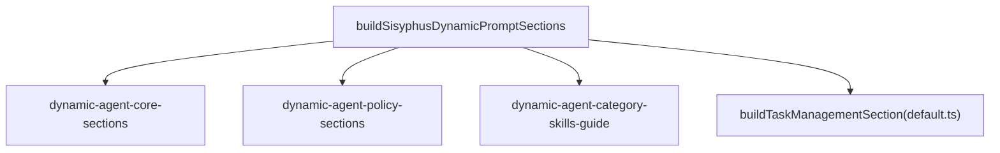
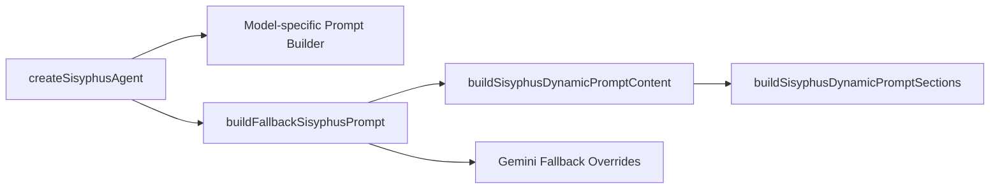

# Sisyphus Dynamic Prompt Builder 源码导读

## 1. 为什么还要单独写这份

前面的文档已经解释了 `Sisyphus` 是总调度器，也解释了它有多套 prompt 变体。但如果只停留在那一层，还是会遗漏一个很关键的点：

`Sisyphus` 的 prompt 不是只有各模型专属文件在起作用，背后还有一条专门的“动态 prompt builder”流水线。

这条线尤其影响：

- fallback prompt 是怎么被拼出来的
- 通用动态 sections 是怎么复用的
- Gemini fallback 为什么能在最后一层再打补丁

## 2. 顶层入口

这一条链的最外层入口是 [sisyphus-dynamic-prompt.ts](/Users/liulei/aiS/oh-my-openagent/packages/omo-opencode/src/agents/sisyphus-dynamic-prompt.ts:10)。

它暴露了两个函数：

- `buildDynamicSisyphusPrompt()`
- `buildFallbackSisyphusPrompt()`

两者关系非常清楚：

1. 先用 `buildSisyphusDynamicPromptContent()` 生成基础动态 prompt
2. 再由 `applyGeminiFallbackOverrides()` 视模型情况给 fallback 结果追加 Gemini 专属纠偏

这说明“Gemini 纠偏”不是写死在主模板里的，而是作为 fallback 的最后一层补丁接上的。

## 3. 第二层：动态 prompt 内容拼装器

真正把大段 prompt 拼起来的是 [sisyphus-dynamic-prompt-builder.ts](/Users/liulei/aiS/oh-my-openagent/packages/omo-opencode/src/agents/sisyphus-dynamic-prompt-builder.ts:13)。

它做的事非常直白：

1. 先调用 `buildSisyphusDynamicPromptSections()` 收集所有 section 片段
2. 再按固定顺序渲染成完整 prompt

渲染顺序是：

- `renderRoleAndIntentSections(sections)`
- `renderExplorationSection(sections)`
- `renderExecutionSections(sections)`
- `renderToneAndConstraintsSection(sections)`

这说明这条 builder 链本质上是在做“结构化 prompt 版模板引擎”。

## 4. 第三层：section 聚合器

[sisyphus-dynamic-prompt-sections.ts](/Users/liulei/aiS/oh-my-openagent/packages/omo-opencode/src/agents/sisyphus-dynamic-prompt-sections.ts:23) 是整个 builder 体系的中枢。

它定义了 `SisyphusDynamicPromptSections`，把所有动态片段整理成一个结构体，包括：

- `agentIdentity`
- `antiPatterns`
- `categorySkillsGuide`
- `delegationTable`
- `exploreSection`
- `hardBlocks`
- `keyTriggers`
- `librarianSection`
- `nonClaudePlannerSection`
- `oracleSection`
- `parallelDelegationSection`
- `taskManagementSection`
- `todoHookNote`
- `toolSelection`

而这些值几乎都不是本地现写的，而是调用 `dynamic-agent-*` 系列通用 builder 来生成。

这一步的意义非常大：它把“可复用的动态知识片段”从具体 prompt 模板里抽了出来。

## 5. section 的来源关系

`buildSisyphusDynamicPromptSections()` 的依赖关系大致是：

具体来说：

- 身份、tool selection、explore/librarian/oracle/delegation table 来自 `dynamic-agent-core-sections`
- hard blocks、anti-patterns 来自 `dynamic-agent-policy-sections`
- category + skills guide 来自 `dynamic-agent-category-skills-guide`
- task/todo 管理由 `default.ts` 的 `buildTaskManagementSection()` 提供

所以这条 builder 链不是自成体系，而是把更底层的通用动态片段收编后，为 `Sisyphus` 服务。

## 6. Role / Intent 层

虽然这次没有把所有 `renderRoleAndIntentSections()` 的实现全文展开，但从 builder 的结构就能看出来，这一层负责的是：

- agent 身份
- intent gate
- 用户意图分类
- 是否进入实现模式
- 非 Claude 模型下对 plan agent 的强化提示

它对应的是 `Sisyphus` 最像“调度脑”的那部分逻辑。

也就是说，这一层主要回答：

- 当前消息到底是什么意图
- 该不该立刻进入实施
- 应该优先走搜索、规划、委派还是直接动手

## 7. Exploration 层

[sisyphus-dynamic-prompt-exploration.ts](/Users/liulei/aiS/oh-my-openagent/packages/omo-opencode/src/agents/sisyphus-dynamic-prompt-exploration.ts:4) 很值得单独看，因为它把 `Sisyphus` 的“调研阶段”写成了硬流程。

它拼进去的内容包括：

- `toolSelection`
- `exploreSection`
- `librarianSection`
- 并行执行规则
- background result collection 协议
- anti-duplication 规则
- 搜索止损条件

这层说明作者对 `Sisyphus` 的预期不是“会查资料”，而是“会并行化地查、会等结果、不会重复查、知道什么时候停”。

尤其值得注意的是：

- `explore/librarian` 被明确定义为 background grep，而不是顾问
- `run_in_background=true` 被当作默认要求
- `background_output` 不能在系统 reminder 之前乱调用
- 调研和直接工具读取之间有明确的并行策略

这本质上已经是一个小型调度协议了。

## 8. fallback prompt 的真实含义

`buildFallbackSisyphusPrompt()` 名字看起来像“低配兜底”，但从实现上看，它并不简单。

它做的是：

1. 用通用动态 builder 拼出一份有完整运行时上下文的 prompt
2. 根据模型再做 Gemini fallback override

也就是说，fallback 不是“什么都没有时随便来一份默认 prompt”，而是：

- 共享动态 sections
- 共享 orchestration policy
- 再按模型追加最小必要纠偏

这是一种很工程化的设计，因为它避免了每个模型都重新维护一份完整 prompt，同时又保留了补丁入口。

## 9. 这条 builder 链的架构价值

我觉得这条动态 builder 线的意义主要有四个：

### 9.1 把动态知识从静态 prompt 中拆出来

比如 agents、skills、categories、tool display 都不是编译期写死的，而是运行时注入。

### 9.2 提高跨变体复用率

许多通用动态片段只维护一份，然后能被多个 prompt 路线共享。

### 9.3 降低模型补丁的修改面

像 Gemini 这样的修正层，不必重写整个 prompt，只需要做最后一层覆盖。

### 9.4 让 `Sisyphus` 真正感知当前生态

因为 prompt 内容本身就会随：

- 可用 agents
- 可用 skills
- 可用 categories
- task system 开关
- 当前 model

一起变化。

## 10. 和 `Sisyphus` 主工厂的关系

可以把主工厂和动态 builder 的关系理解成：

也就是说：

- 有专属变体时，主工厂直接走对应 builder
- 没有专属变体时，走动态 builder + fallback overrides

这是一套“变体优先，动态 fallback 兜底”的结构。

## 11. 对阅读源码的人最有帮助的理解方式

如果你后面再读 `Sisyphus`，我建议不要把它看成一堆 prompt 文件，而要看成三层：

1. `createSisyphusAgent` 决定走哪条 prompt 路线
2. `sisyphus-dynamic-prompt*` 负责 fallback 路线的结构化组装
3. `dynamic-agent-*` 提供可复用的动态 section 库

一旦按这三层去看，很多散落在文件里的规则就会突然变得清楚。

## 12. 一句话总结

`Sisyphus` 的 dynamic prompt builder，本质上是一套“把运行时 agent 生态实时编译进 prompt”的模板引擎。
