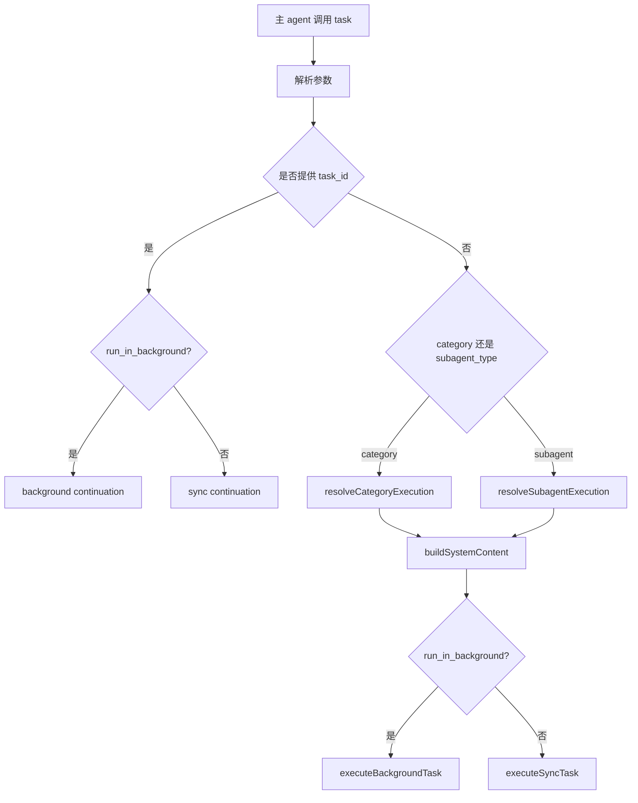

# `task` 工具执行管线深拆

本文聚焦 oh-my-openagent 里最关键的“委派入口” `task`。它不是一个单纯的“调用另一个 agent”的快捷键，而是把分类路由、子 agent 解析、模型选择、技能注入、同步执行、后台执行、续跑恢复统一收口到一个工具里。

相关源码入口：

- [`packages/omo-opencode/src/tools/delegate-task/tools.ts`](/Users/liulei/aiS/oh-my-openagent/packages/omo-opencode/src/tools/delegate-task/tools.ts)
- [`packages/omo-opencode/src/tools/delegate-task/category-resolver.ts`](/Users/liulei/aiS/oh-my-openagent/packages/omo-opencode/src/tools/delegate-task/category-resolver.ts)
- [`packages/omo-opencode/src/tools/delegate-task/subagent-resolver.ts`](/Users/liulei/aiS/oh-my-openagent/packages/omo-opencode/src/tools/delegate-task/subagent-resolver.ts)
- [`packages/omo-opencode/src/tools/delegate-task/prompt-builder.ts`](/Users/liulei/aiS/oh-my-openagent/packages/omo-opencode/src/tools/delegate-task/prompt-builder.ts)
- [`packages/omo-opencode/src/tools/delegate-task/sync-task.ts`](/Users/liulei/aiS/oh-my-openagent/packages/omo-opencode/src/tools/delegate-task/sync-task.ts)
- [`packages/omo-opencode/src/tools/delegate-task/background-task.ts`](/Users/liulei/aiS/oh-my-openagent/packages/omo-opencode/src/tools/delegate-task/background-task.ts)
- [`packages/omo-opencode/src/tools/delegate-task/sync-continuation.ts`](/Users/liulei/aiS/oh-my-openagent/packages/omo-opencode/src/tools/delegate-task/sync-continuation.ts)
- [`packages/omo-opencode/src/tools/delegate-task/background-continuation.ts`](/Users/liulei/aiS/oh-my-openagent/packages/omo-opencode/src/tools/delegate-task/background-continuation.ts)

## 1. 为什么 `task` 是整套系统的中枢

在这个项目里，用户表面上看到的是“主 agent 可以把事情交给别的 agent 做”。但源码层面上，真正承担这个责任的不是单个 agent，而是 `task` 这层委派框架。

它统一解决了 6 类问题：

1. 这次委派是按 `category` 路由，还是按 `subagent_type` 直指某个 agent。
2. 子任务应该同步执行还是后台异步执行。
3. 子任务是否是全新任务，还是基于旧 session 的 continuation。
4. 该子任务应该继承什么模型，是否需要 fallback 链。
5. 该给子任务注入哪些技能、附加 system prompt、类别补充提示。
6. 父 session 如何追踪这个子任务的 session、状态、元数据和恢复入口。

所以 `task` 更像一个“子代理调度总线”，而不是一个普通工具。

## 2. 总体控制流

这条主线都在 [`tools.ts`](/Users/liulei/aiS/oh-my-openagent/packages/omo-opencode/src/tools/delegate-task/tools.ts) 里收口。

## 3. 参数语义不是“表单字段”，而是执行模式开关

`DelegateTaskArgs` 定义在 [`types.ts`](/Users/liulei/aiS/oh-my-openagent/packages/omo-opencode/src/tools/delegate-task/types.ts)，核心字段如下：

- `description`：给人和 UI 看的任务标题，也参与后台任务状态展示。
- `prompt`：真正交给子 agent 的工作内容。
- `category`：按能力分类委派，最终通常会落到 `sisyphus-junior`。
- `subagent_type`：直接指定子 agent。
- `run_in_background`：决定走同步链还是后台链。
- `task_id`：不是“这次任务的编号”，而是 continuation 的入口。
- `load_skills`：显式要求对子任务装载的技能。
- `command`：和 slash command、调度上下文有关的附带字段。

也就是说，`task` 的参数结构本身就是一个状态机输入。

## 4. 分类委派：先定类别，再把执行收束到 `sisyphus-junior`

### 4.1 核心结论

按 `category` 委派时，系统并不是“每个 category 对应一个 agent”，而是：

- 先为 category 解模型、解变体、解 prompt append；
- 再统一把执行目标指向 `SISYPHUS_JUNIOR_AGENT`；
- 由 `sisyphus-junior` 在它自己的 prompt 里扮演类别专家。

这段关键逻辑在 [`category-resolver.ts`](/Users/liulei/aiS/oh-my-openagent/packages/omo-opencode/src/tools/delegate-task/category-resolver.ts)。

返回结果里直接写死：

- `agentToUse: SISYPHUS_JUNIOR_AGENT`

这说明 category 不是 agent 注册层的一级实体，而是 `sisyphus-junior` 的运行角色。

### 4.2 category 解析实际做了什么

`resolveCategoryExecution()` 做的事情远比“检查 category 是否存在”复杂：

1. 合并用户 categories 配置。
2. 拉取当前可用模型列表。
3. 解析 category 对应的模型需求和默认配置。
4. 处理三层优先级：
   `category 显式 model > sisyphus-junior 默认 model > category 默认 model`
5. 构造 `ModelFallbackInfo`，让 UI/通知层知道这次模型来源。
6. 生成 `categoryPromptAppend`，把类别特定要求拼到 prompt 体系里。
7. 判断是否属于 unstable agent 路径。
8. 生成 fallback chain，用于运行时模型降级重试。

### 4.3 “不稳定模型”是特殊执行支路

这块是一个很容易忽略但很重要的设计点。

`resolveCategoryExecution()` 会把包含 `gemini` 或 `minimax` 的模型识别为 `isUnstableAgent`，除非配置里明确覆写。这意味着：

- category 解析不只是“产出模型”；
- 它还会影响后续采用哪种执行策略。

换句话说，category resolver 已经带有调度策略含义，而不只是配置查表器。

## 5. 直指子 agent：`subagent_type` 走另一条解析链

如果调用者不是按 category，而是按 `subagent_type` 直接指定子 agent，则进入 [`subagent-resolver.ts`](/Users/liulei/aiS/oh-my-openagent/packages/omo-opencode/src/tools/delegate-task/subagent-resolver.ts)。

这条链路更偏“身份解析”：

1. `validateSubagentRequest()` 先做 preflight。
2. `resolveSubagentAgentMatch()` 处理 agent 名称映射、候选匹配和合法性。
3. `resolveSubagentModel()` 为目标 agent 决定模型和 fallback。

这里的重点不是 category 扮演，而是：

- 目标 agent 是否允许被调用；
- 目标 agent 该用什么模型；
- 该模型对应什么降级链。

所以 `category` 与 `subagent_type` 看起来都是“选一个能力”，本质却不同：

- `category` 是“把工作抽象成领域能力，再交给 `sisyphus-junior` 扮演执行”。
- `subagent_type` 是“直接命中具体 agent 身份与其运行约束”。

## 6. Prompt 构建：不仅拼文本，还决定子任务的可用能力说明

[`prompt-builder.ts`](/Users/liulei/aiS/oh-my-openagent/packages/omo-opencode/src/tools/delegate-task/prompt-builder.ts) 做了两件关键事：

1. `buildSystemContent()`：组装给子任务的 system 注入内容。
2. `buildTaskPrompt()`：在真正 user prompt 上追加 plan agent 特定约束。

### 6.1 `buildSystemContent()` 的构成

它会把这些来源合并起来：

- 显式加载的 skill 内容；
- category 的 prompt append；
- `agentsContext`；
- planning agent prepend；
- 可用 skills 列表；
- native skill 列表。

其中一个很有意思的设计是 `<available_skills>` 区块。它不是直接把 skill 内容塞进去，而是先告诉子 agent：

- 现在有哪些技能；
- 这些技能做什么；
- 你可以通过 `load_skills` 参数显式装载它们。

这意味着 `task` 不只是把 prompt 传下去，它还把“子 agent 的能力发现界面”一并搭起来。

### 6.2 plan agent 会被额外约束

如果目标 agent 属于 plan family，`buildTaskPrompt()` 会自动追加：

- 用英文回答；
- 计划要适合 ultrawork 执行；
- 计划要包含 atomic commit strategy；
- 默认还会加上 TDD-oriented planning。

这说明 planning agent 在这个系统里并不是一个自由聊天代理，而是一个被严格流程化的“产出计划工单的编排代理”。

## 7. 同步执行链：真的创建子 session，然后等待它完成

同步执行主入口是 [`sync-task.ts`](/Users/liulei/aiS/oh-my-openagent/packages/omo-opencode/src/tools/delegate-task/sync-task.ts)。

它的工作可以概括成 5 步：

1. 预留 sync subagent spawn，控制并发/父子关系。
2. 创建真正的子 session。
3. 注册该 session 的副作用和上下文。
4. 进入轮询循环等待任务完成。
5. 把结果拿回父 session，并清理所有副作用。

### 7.1 同步不是“阻塞当前线程”，而是“阻塞父 agent 的逻辑推进”

`executeSyncTask()` 并不是本地开线程执行，而是：

- 通过 OpenCode session API 创建一个新的子会话；
- 把 prompt 发给这个子会话；
- 然后轮询它的消息与状态；
- 最终把 deliverable 拉回当前工具返回值。

所以同步任务本质上仍是“多 session 协作”，只是父 agent 会等它交卷。

### 7.2 为什么完成后要主动 abort 子 session

这是源码里一个非常值得单独强调的防御性设计。

`executeSyncTask()` 在 `finally` 里会：

- `handedBackSyncSessions.add(syncSessionID)`
- `client.session.abort(syncSessionID)`

注释写得很明确：这样做是为了阻止 continuation/todo enforcer 看到子 session 还 idle 且有未完成 todo 后，把它再次唤醒。

换句话说，系统作者非常清楚：

- sync 子任务虽然“逻辑上完成了”，
- 但 OpenCode 侧 session 还活着，
- 若不显式收口，别的 hook 会把它误认为还能继续跑。

这体现了这个项目的一个核心现实：很多代码都在防御 harness 本身的异步状态竞态。

## 8. 后台执行链：先返回 `bg_*` 壳，再等待 `ses_*` 真正落地

后台执行主入口是 [`background-task.ts`](/Users/liulei/aiS/oh-my-openagent/packages/omo-opencode/src/tools/delegate-task/background-task.ts)。

### 8.1 两层 ID 分离是这条链的关键

后台任务返回给调用方的第一标识是：

- `Background Task ID: bg_...`

但它内部真正运行的还是一个子 session：

- `sessionId: ses_...`

这两个 ID 在源码中被严格区分：

- `bg_*` 是后台任务管理器层的任务壳。
- `ses_*` 是 OpenCode 内部真正跑 agent 的会话。

### 8.2 为什么 launch 后还要“等一下 session 出现”

`manager.launch()` 会立刻返回，但这时 session 可能还没创建好。

于是 `executeBackgroundTask()` 里专门有：

- `waitForBackgroundSessionStart()`
- `continueSessionSetup()`

源码注释提到，如果拿不到 `sessionId` 就发布元数据，OpenCode TUI 里这个子任务会一直显示成 spinner，没有可点击跳转目标。

这不是业务语义问题，而是前端/运行时时序耦合问题。也正因为此，后台任务并不是 fire-and-forget，它启动后还有一段“等待绑定真正 session”的收尾阶段。

### 8.3 后台链会注册 fallback 和 category 上下文

一旦 `sessionId` 真正出现，后台任务还会把两个上下文注册进去：

- `modelFallbackControllerAccessor.setSessionFallbackChain()`
- `SessionCategoryRegistry.register()`

这意味着后台子 session 不是孤立的“黑盒执行单元”，它仍然被纳入整个 OMO 的模型 fallback 和 category 追踪体系。

## 9. continuation：`task_id` 不是复用任务，而是复用子 session

### 9.1 后台 continuation

[`background-continuation.ts`](/Users/liulei/aiS/oh-my-openagent/packages/omo-opencode/src/tools/delegate-task/background-continuation.ts) 说明：

- continuation 输入里的 `task_id` 实际上取的是旧子 session 标识；
- `manager.resume()` 会基于旧上下文重新挂出一个新的后台任务壳；
- 返回值里既给新 `backgroundTaskId`，也保留原 `sessionId`。

也就是说，后台 continuation 的本质是：

- session 上下文延续，
- 后台管理任务实例重建。

### 9.2 同步 continuation

[`sync-continuation.ts`](/Users/liulei/aiS/oh-my-openagent/packages/omo-opencode/src/tools/delegate-task/sync-continuation.ts) 则直接继续已有 session。

它会：

1. 先读旧 session 的消息，倒序找最近一次 agent/model 信息。
2. 恢复 `resumeAgent`、`resumeModel`、`resumeVariant`。
3. 重新设置该 session 的工具限制。
4. 再次向同一个 session 发送 continuation prompt。
5. 轮询并抓取新的结果。

所以同步 continuation 的本质是：

- 同一个子 session 的再次推进，
- 而不是新建一个替代 session。

## 10. `task` 的真正系统角色

从源码看，`task` 在整个项目里的角色可以总结为三层：

### 10.1 调度层

它决定：

- 谁来做；
- 用哪个模型做；
- 同步还是异步；
- 是新任务还是续跑。

### 10.2 Prompt 编排层

它决定：

- 子 agent 能看到哪些 skill；
- 该补哪些类别提示；
- planning agent 要受哪些额外约束。

### 10.3 会话治理层

它维护：

- 父子 session 关系；
- `bg_*` 与 `ses_*` 的映射；
- fallback chain 与 category 注册；
- 任务元数据；
- 完成后的 session 清理与防重启。

所以如果说 Sisyphus 是“主执行脑”，那 `task` 更像是这个系统的“子任务操作系统内核接口”。

## 11. 对理解项目架构最重要的几个结论

### 11.1 category 不等于 agent

category 主要路由到 `sisyphus-junior`，它是一层“能力角色抽象”，不是 agent 注册表里的并列实体。

### 11.2 sync/background 不是 UX 选项，而是两套会话治理模型

同步路径要关心结果回收和防二次唤醒，后台路径要关心 `bg_*` 与 `ses_*` 的延迟绑定和后续查询。

### 11.3 continuation 的核心资产是 session 上下文

无论 sync 还是 background，真正被复用的都是原子 session 的历史状态，而不是一个“任务对象”。

### 11.4 `task` 是 agent 协作基础设施，不是业务工具

它把 agent、模型、skills、hooks、session API、toast、tool metadata、fallback、TUI 呈现全部连在一起，因此它实际上属于整个 OMO agent OS 的基础设施层。
