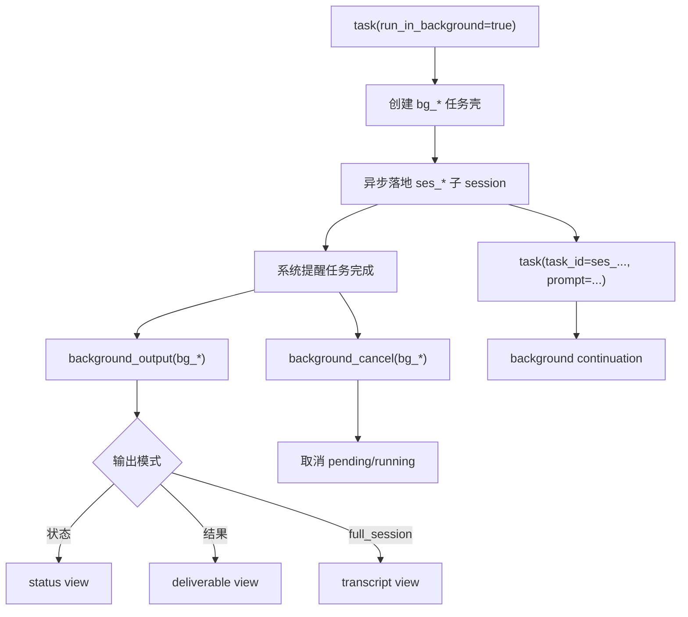

# 后台任务运行模型：`background_output` 与 `background_cancel`

前一篇讲的是 `task` 如何发起后台子任务，这一篇专门拆后台任务“运行后”如何被观测、读取、取消和恢复。相关实现虽然暴露成两个工具，但底层其实是一套明确的后台任务运行模型。

关键源码：

- [`packages/omo-opencode/src/tools/background-task/tools.ts`](/Users/liulei/aiS/oh-my-openagent/packages/omo-opencode/src/tools/background-task/tools.ts)
- [`packages/omo-opencode/src/tools/background-task/create-background-output.ts`](/Users/liulei/aiS/oh-my-openagent/packages/omo-opencode/src/tools/background-task/create-background-output.ts)
- [`packages/omo-opencode/src/tools/background-task/create-background-cancel.ts`](/Users/liulei/aiS/oh-my-openagent/packages/omo-opencode/src/tools/background-task/create-background-cancel.ts)
- [`packages/omo-opencode/src/tools/delegate-task/background-task.ts`](/Users/liulei/aiS/oh-my-openagent/packages/omo-opencode/src/tools/delegate-task/background-task.ts)
- [`packages/omo-opencode/src/tools/delegate-task/background-continuation.ts`](/Users/liulei/aiS/oh-my-openagent/packages/omo-opencode/src/tools/delegate-task/background-continuation.ts)

## 1. 它不是两个小工具，而是一套“后台作业观察协议”

表面上看：

- `task(..., run_in_background=true)` 负责发起后台任务；
- `background_output` 负责看输出；
- `background_cancel` 负责取消。

但源码层面上，这三者共同定义了一个后台作业协议：

1. 发起时先创建一个 `bg_*` 任务壳。
2. 真正执行体是内部的 `ses_*` session。
3. 工具元数据同时记录任务标题、agent、category、description、session 映射。
4. 查询时默认按 `bg_*` 任务 ID 读取，而不是直接按 session。
5. 取消时可只停 pending/running 的后台任务，不动其它状态。
6. continuation 时沿用旧 `ses_*` 上下文，但可能生成新的后台任务实例。

这是一种显式的“后台编排协议”，不是几个散落 helper 的凑合拼接。

## 2. 最关键的边界：`bg_*` 不是 `ses_*`

这是理解后台任务最重要的一条。

### 2.1 背景任务双层身份

后台任务总有两套标识：

- `bg_*`：任务管理器里的后台任务 ID。
- `ses_*`：OpenCode 真正跑子 agent 的 session ID。

这个边界在 [`create-background-output.ts`](/Users/liulei/aiS/oh-my-openagent/packages/omo-opencode/src/tools/background-task/create-background-output.ts) 里甚至做了专门防呆：

- 如果传进来的是 `ses_*`，它会提示“`background_output` 期待的是 `bg_*`，不是 session ID”。

这说明项目作者非常担心上层 agent 或用户把“后台任务实例”和“底层执行 session”混为一谈。

### 2.2 为什么必须分层

因为后台任务系统承担的不是“读会话消息”这么简单，它还要处理：

- 任务状态机；
- 完成通知；
- UI 侧任务列表；
- 可取消性；
- continuation 后的新任务壳；
- 和父 session 的追踪关系。

而这些概念都不适合直接挂在原始 session 上，所以才需要 `bg_*` 这一层 orchestration identity。

## 3. `background_output` 的职责：不是读日志，而是按任务状态返回合适视图

### 3.1 入口逻辑

`createBackgroundOutput()` 返回的是一个 OpenCode tool，它的核心执行流程可以概括为：

1. 根据 `task_id` 查 `BackgroundManager`。
2. 如果一开始没查到并且像 `bg_*`，短暂重试一次。
3. 发布当前任务元数据。
4. 根据 `block`/`timeout` 决定要不要等待。
5. 根据 `full_session` 决定返回完整消息视图还是摘要视图。
6. 根据任务状态选择最终输出格式。

这意味着 `background_output` 不是被动读取器，而是“任务状态感知型输出选择器”。

### 3.2 为什么“第一次查不到要重试”

源码里有个很有代表性的处理：

- `getTaskWithMissingRetry()`

它会在首次找不到 `bg_*` 任务时等待 `100ms` 再查一次。

这背后的现实是：

- 后台任务启动与登记之间存在竞态；
- 查询调用可能比管理器状态落地更快一步到达。

这里再次说明，这个项目的很多工程复杂度不是业务逻辑，而是 agent runtime 的异步时序治理。

## 4. `background_output` 实际有三种读取模式

### 4.1 状态模式

如果任务还没完成，又没要求 `full_session`，它返回的是任务状态摘要。

这类摘要更像：

- 当前 status；
- 当前 agent/category/description；
- 是否仍在运行。

适合“我只想知道它做完没”。

### 4.2 结果模式

如果任务 `completed`，默认走 `formatTaskResult()`。

这意味着它优先返回“任务交付物”，而不是整段原始消息历史。这个设计明显是在照顾上层 agent：

- 上层最关心的不是完整 transcript；
- 而是这次子任务产出了什么。

### 4.3 全会话模式

如果 `full_session=true`，则改走 `formatFullSession()`，并支持：

- `include_thinking`
- `message_limit`
- `since_message_id`
- `include_tool_results`
- `thinking_max_chars`
- `from_end`

这个模式更接近“带过滤器的 session transcript 读取器”。

所以 `background_output` 同时覆盖了：

- 运维视角：看任务状态；
- 协作视角：看最终结果；
- 调试视角：看完整会话。

## 5. `block` 的真正含义：临时等待，不是把后台任务变同步

工具参数里支持 `block=true`，但它的语义不是“让后台任务变成同步任务”，而是：

- 先按后台任务模型启动；
- 然后在读取输出时暂时轮询一段时间；
- 若超时仍活跃，就返回最新状态并附 timeout note。

源码中：

- 轮询间隔为 `100ms`
- 默认超时 `60000ms`
- 上限 `600000ms`

这说明 `block` 更像一个“观测策略”而不是“调度策略”。后台任务在系统建模上依旧是后台任务。

## 6. thinking 和 tool results 的处理很克制

一个很细但很重要的设计：

- 当任务还在运行时，`includeThinking` 和 `includeToolResults` 会更宽松；
- 任务完成后，是否展示这些内容则更多依赖调用参数。

这代表系统对两类消费场景做了区分：

1. 任务进行中时，调试和跟踪更重要。
2. 任务完成后，默认交付结果更重要，避免噪音过多。

这也是 OMO 一贯的风格：既保留 agent trace 能见度，又尽量不让正常调用被冗长内部细节淹没。

## 7. `background_cancel` 的职责：停止后台编排，而不只是中断 session

[`create-background-cancel.ts`](/Users/liulei/aiS/oh-my-openagent/packages/omo-opencode/src/tools/background-task/create-background-cancel.ts) 展示了后台取消的真实语义。

### 7.1 支持两种取消方式

- 取消单个任务：`taskId`
- 批量取消所有运行中或等待中的后台任务：`all=true`

### 7.2 取消条件是状态驱动的

它只允许取消：

- `pending`
- `running`

如果任务已经是：

- `completed`
- `error`
- `cancelled`
- `interrupt`

则不会再走取消流程。

这说明后台任务层本身有一套明确状态机，取消工具只是该状态机的合法入口之一。

### 7.3 为什么要区分 pending 和 running

调用 `manager.cancelTask()` 时会额外带：

- `abortSession: originalStatus === "running"`

这意味着：

- `pending` 任务可能还没真正落到 session，取消时无需中断实际 agent；
- `running` 任务则必须连内部 session 一起 abort。

这里再次体现双层身份模型：

- 取消后台任务，不等于总是取消一个已存在的 session；
- 是否需要碰到底层 session，取决于后台任务当前所处阶段。

## 8. continuation 为什么还能继续

后台任务被取消或完成后，源码仍然给出 continuation 路径。

在 `background_cancel` 的批量取消返回值里，若某任务已有关联 `sessionID`，还会显式提示：

```text
task(task_id="<task_id>", prompt="Continue: <your follow-up>")
```

这说明对系统来说，“后台任务是否还活着”和“底层子 session 是否还有可复用上下文”是两回事。

也就是说：

- 后台任务实例可以结束；
- 但它背后的 session 仍然可能作为 continuation 基底继续被使用。

这和前面那条核心设计完全一致：session 是上下文资产，后台任务只是编排外壳。

## 9. 后台任务的 UI/元数据设计也很讲究

`background_output` 在执行时会发布工具元数据，包括：

- `backgroundTaskId`
- `agent`
- `category`
- `description`
- `sessionId`

而 `task` 在后台启动时也会补 `buildTaskMetadataBlock()`。

这说明后台任务系统并不满足于“能跑就行”，它还在有意识地为：

- TUI 展示；
- 工具调用历史；
- 任务导航；
- 父子协作可观测性

构建稳定的数据契约。

这也是为什么源码里会专门等待 `sessionId` 出现后再发 metadata。没有这个映射，前端和调试体验就会明显退化。

## 10. 后台任务运行模型总结

可以把它概括成下面这张图：



## 11. 对项目架构理解最重要的结论

### 11.1 后台任务不是 session 的别名

它是 session 之上的一层编排实体，解决状态、通知、取消、UI 和恢复问题。

### 11.2 `background_output` 是“视图选择器”

它根据任务状态和参数，在状态视图、结果视图、全会话视图之间切换，而不是简单地 dump 数据。

### 11.3 `background_cancel` 取消的是编排生命周期

只有在任务已经进入 running 阶段时，才会进一步 abort 底层 session。

### 11.4 真正可持续复用的是 `ses_*` 上下文

`bg_*` 任务实例可以结束、被替换、被重建，但真正支持 continuation 的资产是内部 session 历史。

从这个角度看，OMO 的后台任务系统更像一个小型作业编排器，而不是一个附带的“异步工具”。
