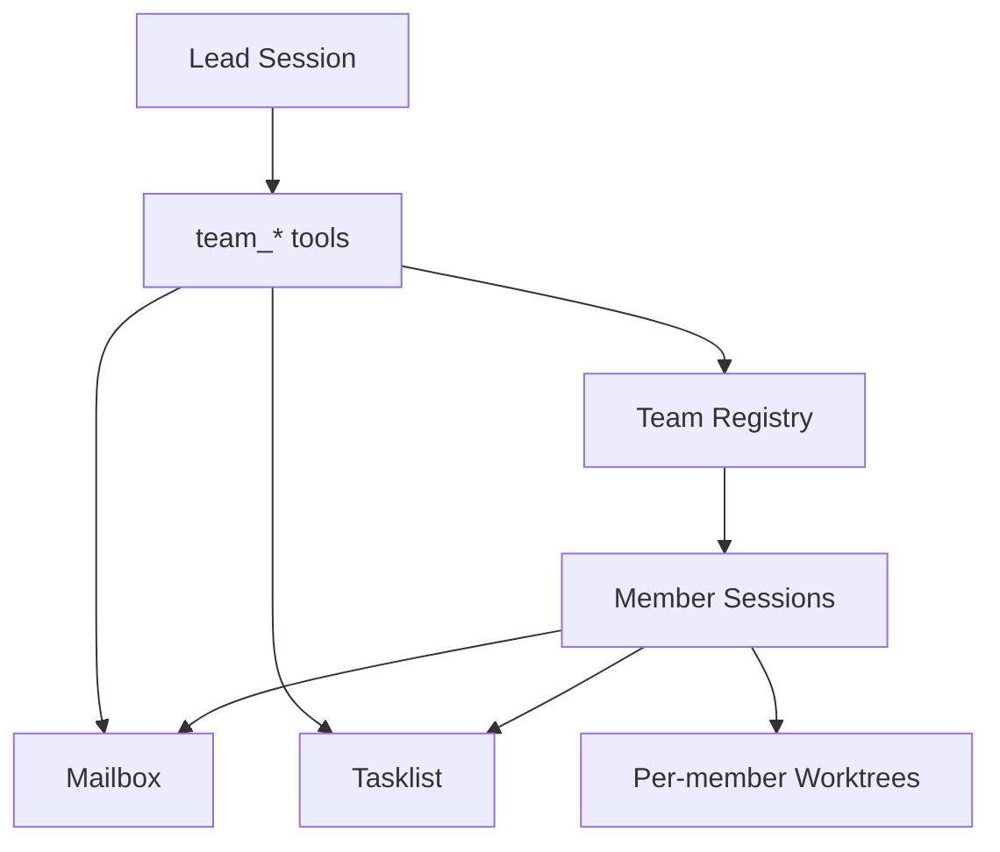

# Team Mode 协作模型导读

## 1. Team mode 在系统里的角色

`team mode` 不是简单的“多开几个 agent”，而是一套并行多 agent 协作运行时。它有：

- team spec
- member eligibility
- shared mailbox
- shared tasklist
- runtime state
- optional tmux layout
- worktrees

说明文档入口在 [features/team-mode/AGENTS.md](/Users/liulei/aiS/oh-my-openagent/packages/omo-opencode/src/features/team-mode/AGENTS.md:1)。

这意味着 `team mode` 更像一个轻量协作系统，而不是一个单一功能开关。

## 2. 开启方式与默认状态

`team mode` 默认关闭，必须显式在配置里把 `team_mode.enabled` 打开。[team-mode/AGENTS.md](/Users/liulei/aiS/oh-my-openagent/packages/omo-opencode/src/features/team-mode/AGENTS.md:5)

配置项不仅有 on/off，还包括：

- 并行成员数上限
- 总成员数上限
- wall clock 限制
- member turn 限制
- 消息载荷限制
- mailbox polling 间隔

这说明它从一开始就被当成“资源受控的协作运行时”来设计。

## 3. 12 个 `team_*` 工具

team mode 打开后，会注册一整套 `team_*` 工具。[team-mode/AGENTS.md](/Users/liulei/aiS/oh-my-openagent/packages/omo-opencode/src/features/team-mode/AGENTS.md:23)

主要包括三类：

### 3.1 生命周期

- `team_create`
- `team_delete`
- `team_shutdown_request`
- `team_approve_shutdown`
- `team_reject_shutdown`

### 3.2 消息与任务

- `team_send_message`
- `team_task_create`
- `team_task_list`
- `team_task_update`
- `team_task_get`

### 3.3 观测

- `team_status`
- `team_list`

从这些工具的形态就能看出来，team mode 的抽象不是“共享一个上下文”，而是“多个成员通过 mailbox 和 tasklist 协作”。

## 4. agent 资格不是平等的

team mode 最有意思的设计之一，是并不是所有 agent 都允许当 team member。

资格表在 [team-mode/AGENTS.md](/Users/liulei/aiS/oh-my-openagent/packages/omo-opencode/src/features/team-mode/AGENTS.md:41)：

- `eligible`：`sisyphus`, `atlas`, `sisyphus-junior`
- `conditional`：`hephaestus`
- `hard-reject`：`oracle`, `librarian`, `explore`, `multimodal-looker`, `metis`, `momus`, `prometheus`

这背后的原因很有逻辑：

- mailbox 协作要求成员能写状态和消息
- 只读顾问型 agent 不适合作为持续协作成员
- 规划型 `prometheus` 也不适合直接进入执行型团队

所以 team mode 不是“谁都能进来组队”，而是对成员角色有严格假设。

## 5. 两种成员类型

team spec 支持两种 member kind：[team-mode/AGENTS.md](/Users/liulei/aiS/oh-my-openagent/packages/omo-opencode/src/features/team-mode/AGENTS.md:48)

- `kind: "subagent_type"`：直接 agent
- `kind: "category"`：通过 `sisyphus-junior` 按 category 路由

这个设计很关键，因为它让 team mode 同时支持：

- 明确指定某个 agent 类型
- 仅指定一个工作域，让系统自己选对应 category worker

换句话说，team mode 兼容了“角色型协作”和“领域型协作”两种组织方式。

## 6. 存储布局说明它是持久运行时

team mode 的状态不是内存里的临时对象，而是有明确持久化布局：[team-mode/AGENTS.md](/Users/liulei/aiS/oh-my-openagent/packages/omo-opencode/src/features/team-mode/AGENTS.md:70)

主要包括：

- `config.json`
- `state.json`
- `mailbox/`
- `tasklist.jsonl`
- `worktrees/{member-name}/`

这说明 team mode 更像一个“磁盘驱动的协作系统”，而不是一个会话内的小把戏。

## 7. 生命周期

team mode 的典型生命周期是：

1. `team_create`
2. 载入 TeamSpec
3. 校验 member eligibility
4. 初始化 mailbox / tasklist / worktrees / 可选 tmux
5. lead 通过消息和任务驱动成员
6. 成员 claim task、执行、回报
7. 通过 shutdown request / approve / reject 进入收尾
8. `team_delete` 清理状态

这条链路在 [team-mode/AGENTS.md](/Users/liulei/aiS/oh-my-openagent/packages/omo-opencode/src/features/team-mode/AGENTS.md:77) 有概述。

## 8. 为什么它不是普通“并行子任务”

普通并行子任务通常是：

- 临时发几个 agent
- 等结果回来
- 没有持续共享状态

而 team mode 不一样，它有：

- mailbox
- task claiming
- runtime state
- session registry
- team lead / member 的角色关系

这意味着 team mode 更接近“长期运行的小型 agent 组织”。

## 9. 和 `delegate-task` 的关系

team mode 和普通 `task` 委派并不是同一种东西。

源码和测试里反复强调：

- read-only agent 用 `delegate-task`
- `prometheus` 这类 plan-only agent 用 `delegate-task`
- team mode 成员不要在内部再乱用 `delegate-task`

也就是说：

- `delegate-task` 更像单点委派机制
- `team mode` 更像多成员协作机制

两者是互补关系，而不是替代关系。

## 10. 和 hooks 的整合

team mode 不是工具层单独存在的，它还会接入 hooks：

- `teamModeStatusInjector`
- `teamMailboxInjector`
- `teamToolGating`
- `team-session-events/*`

这意味着团队状态不仅保存在存储里，还会被重新注入主循环，影响 agent 看到的上下文和可用动作。

所以 team mode 的协作不是“外部系统协作”，而是已经被嵌进 agent loop 本身。

## 11. 一个简化模型

## 12. 一句话总结

team mode 本质上是一个把多个 agent 组织成“有成员、任务、消息和状态”的协作运行时。
