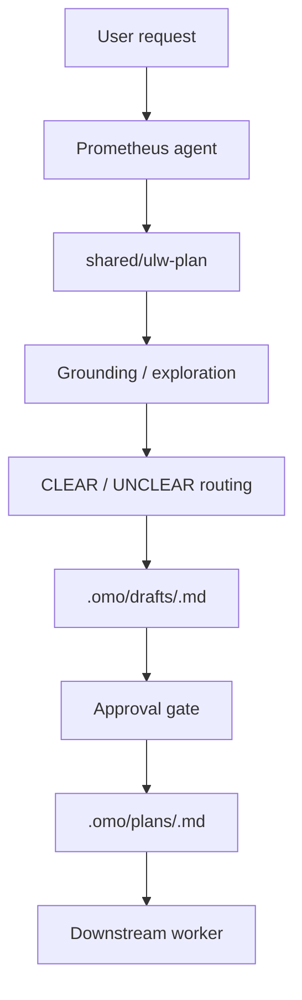

# Prometheus 与规划链路源码导读

## 1. Prometheus 在系统里到底是什么

`Prometheus` 不是一个通用实现 agent，而是一个“规划控制面”角色。这个定位在它的说明里非常明确：它是 interview-mode strategic planner，负责把模糊任务变成 decision-complete 的工作计划，不负责实施。[packages/omo-opencode/src/agents/prometheus/AGENTS.md](/Users/liulei/aiS/oh-my-openagent/packages/omo-opencode/src/agents/prometheus/AGENTS.md:10)

如果换成更工程化的说法：

- `Sisyphus` 像总调度器
- `Atlas` 像清单推进器
- `Hephaestus` 像深度执行工
- `Prometheus` 像规划控制台

## 2. Prompt 侧：它是一个薄适配器

`Prometheus` 的 prompt 加载非常薄，几乎没有模型分支逻辑。入口在 [system-prompt.ts](/Users/liulei/aiS/oh-my-openagent/packages/omo-opencode/src/agents/prometheus/system-prompt.ts:10)。

这里做的事情很简单：

1. 从 `prompts-core` 读取 `prometheus/default.md`
2. 暴露成 `PROMETHEUS_SYSTEM_PROMPT`
3. `getPrometheusPrompt()` 无论传什么模型，返回的都是同一份 prompt

这说明 `Prometheus` 的核心行为并不在 agent 侧 prompt 里复杂分流，而是被有意识地外置到了共享 skill 层。

## 3. 真正的行为核心：`shared/ulw-plan`

`Prometheus` 的关键不在它自己写了多少提示，而在于它被设计成“第一步必须加载 `shared/ulw-plan`”。这一点在 skill 本体里写得非常明确：[packages/shared-skills/skills/ulw-plan/SKILL.md](/Users/liulei/aiS/oh-my-openagent/packages/shared-skills/skills/ulw-plan/SKILL.md:1)

这份 skill 定义了几件大事：

- 哪些任务必须先计划后编码
- 如何区分 `CLEAR` 和 `UNCLEAR` 意图
- 何时问用户，何时自己补全默认决策
- 如何写 `.omo/drafts/<slug>.md`
- 如何写 `.omo/plans/<slug>.md`
- 何时停在 approval gate 等待用户

所以 `Prometheus` 更像一个“把控制权交给 `ulw-plan` skill 的运行时壳”。

## 4. CLEAR / UNCLEAR 路由是这条链路的核心

`ulw-plan` skill 最重要的设计之一，是把规划前的意图判断分成：

- `CLEAR`
- `UNCLEAR`
- `ON THE FENCE`

这不是表面形式判断，而是按“用户最终想要的 outcome 是否清楚”来判断。[ulw-plan/SKILL.md](/Users/liulei/aiS/oh-my-openagent/packages/shared-skills/skills/ulw-plan/SKILL.md:17)

含义是：

- `CLEAR`：用户知道要什么，剩下只是偏好和权衡
- `UNCLEAR`：用户连要什么都还模糊，这时不能把规划责任甩回给用户
- `ON THE FENCE`：宁可多问一个问题，也不要误把 clear 路由成 unclear

这条规则特别能体现本仓库的设计哲学：规划不是简单地列 todo，而是先判断“决策应该由谁做”。

## 5. Prometheus 的配置构建

虽然 `Prometheus` 没走普通 agent factory，但它的配置构建逻辑依然很完整，入口在 [prometheus-agent-config-builder.ts](/Users/liulei/aiS/oh-my-openagent/packages/omo-opencode/src/plugin-handlers/prometheus-agent-config-builder.ts:41)。

这里主要处理：

1. category override
2. model resolution
3. fallback chain 判断
4. thinking / reasoningEffort / textVerbosity / temperature / top_p / maxTokens 等参数合并
5. prompt 与 `prompt_append` 合并

这里特别有意思的是 `shouldUseCurrentModel` 判断：只有当前模型命中了 `Prometheus` 自己的 fallback chain，才会把当前模型沿用进去。[prometheus-agent-config-builder.ts](/Users/liulei/aiS/oh-my-openagent/packages/omo-opencode/src/plugin-handlers/prometheus-agent-config-builder.ts:61)

这说明 `Prometheus` 虽然 prompt 本身不分模型，但配置层仍然保留了完整的模型解析管线。

## 6. 权限设计：看似宽，实际被 hook 收紧

在 [system-prompt.ts](/Users/liulei/aiS/oh-my-openagent/packages/omo-opencode/src/agents/prometheus/system-prompt.ts:3) 里，`PROMETHEUS_PERMISSION` 看起来并不算严格：

- `edit: allow`
- `bash: allow`
- `webfetch: allow`
- `question: allow`

但这不代表 `Prometheus` 可以乱改代码。真正限制它的，不是这里的 permission 字面值，而是后续的 hook，尤其是 `prometheus-md-only`。

也就是说：

- permission 层给了“可以行动”的基本表面能力
- hook 层再把它收束成“只能在规划边界内行动”

这是本项目里很典型的两层控制模式。

## 7. `prometheus-md-only` 是真实边界

`prometheus-md-only` hook 在 session hooks 中被专门注册。[create-session-hooks.ts](/Users/liulei/aiS/oh-my-openagent/packages/omo-opencode/src/plugin/hooks/create-session-hooks.ts:189)

这意味着 `Prometheus` 的“只能改 `.md`”并不是光靠 prompt 自觉，而是运行时治理的一部分。

从团队模式的测试与说明也能看出，作者明确把 `Prometheus` 定义成：

- plan-mode only
- 只能写 `.omo/*.md`
- 不适合直接参与 team mailbox 这种执行通信流

所以 `Prometheus` 的真正边界不是“它擅长规划”，而是“系统强制它停留在规划域”。

## 8. 规划产物如何落盘

`ulw-plan` 明确要求在生成计划时运行脚手架：

`node "<skill-root>/scripts/scaffold-plan.mjs" <slug> [--clear|--unclear]`

然后由脚手架创建：

- `.omo/drafts/<slug>.md`
- `.omo/plans/<slug>.md`

并要求后续只在既定结构上 append，不要重写头部。[ulw-plan/SKILL.md](/Users/liulei/aiS/oh-my-openagent/packages/shared-skills/skills/ulw-plan/SKILL.md:36)

这说明作者把“计划文件结构一致性”也工程化了，而不是依赖 agent 自己稳定输出 markdown。

## 9. 它和执行阶段如何衔接

`Prometheus` / `ulw-plan` 的 stop rule 非常明确：

- 计划写完就停
- brief 给完就停
- approval gate 设完就停
- never begin execution yourself

也就是说，规划阶段的完成并不意味着任务开始执行，而是意味着“已经生成了一个 downstream worker 可零访谈执行的计划”。[ulw-plan/SKILL.md](/Users/liulei/aiS/oh-my-openagent/packages/shared-skills/skills/ulw-plan/SKILL.md:86)

这和很多 agent 系统把“plan”当作执行前奏不同，这里是把它做成了一段独立的控制流。

## 10. 一个简化流程图

## 11. 为什么这条链很重要

我觉得 `Prometheus` 这条线的价值在于，它把“规划”从一种模糊能力，变成了一个可治理的运行时阶段：

- 有明确技能入口
- 有意图分类规则
- 有落盘格式
- 有 approval gate
- 有 stop rules
- 有执行边界

这会让系统在大任务上比“边想边做”的 agent 更稳。

## 12. 一句话总结

`Prometheus` 不是实现者，而是把模糊需求加工成“可直接交给执行 agent 的决策完备计划”的规划控制面。
